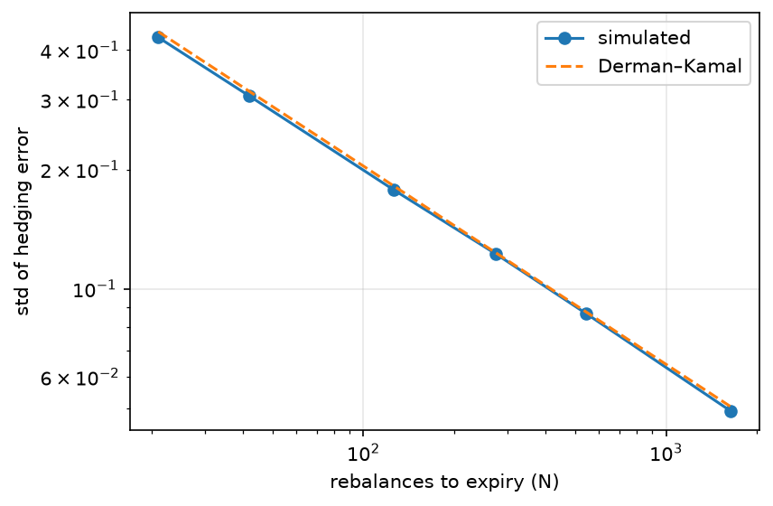
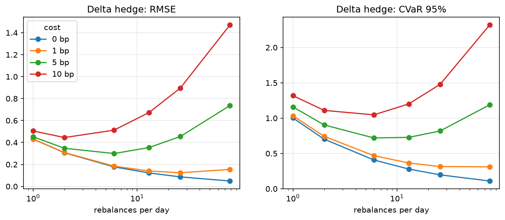
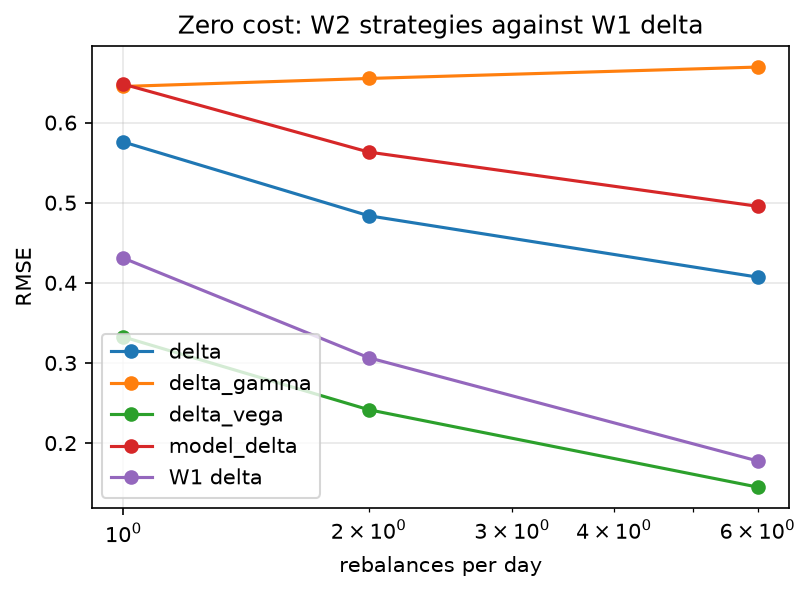
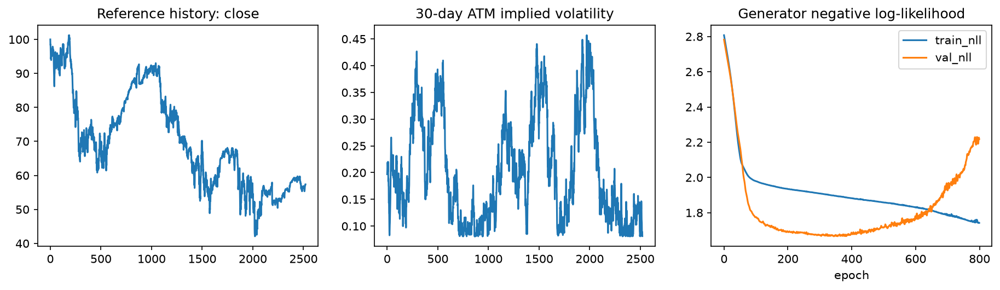
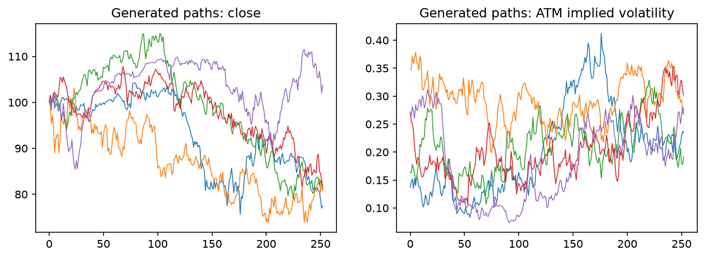
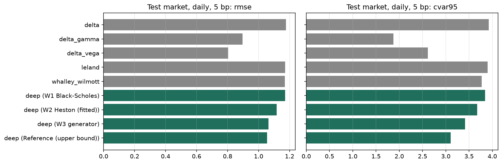
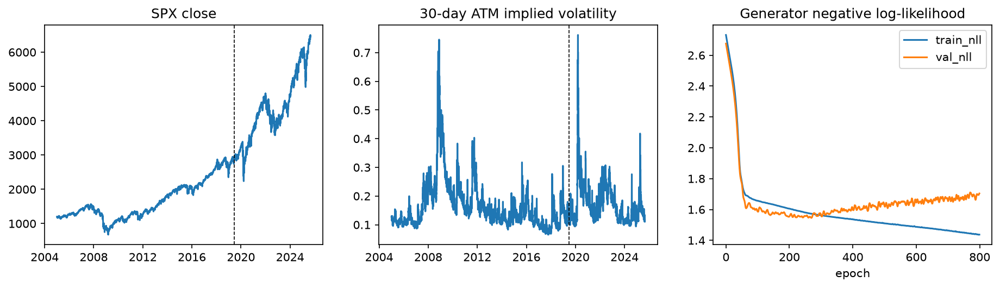
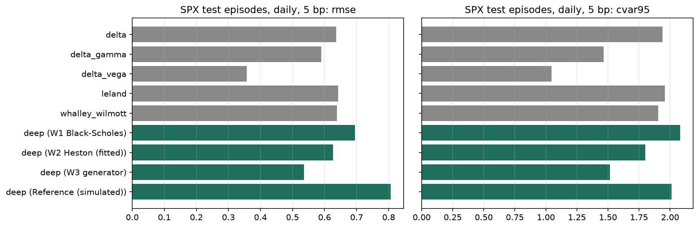
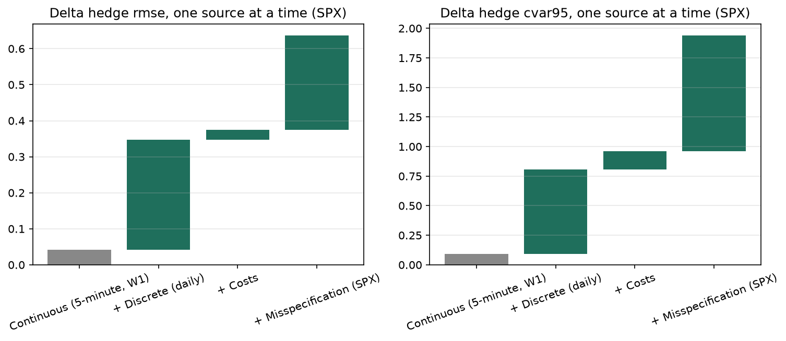

# Hedging error under discrete, costly and misspecified hedging: from simulation to real S&P 500 options

QF209 · A5 Derivative Hedging Strategies

## Summary

A bank that sells an option hedges it by trading the underlying and, sometimes, a second option. Black–Scholes makes the hedge exact under continuous trading, zero costs and a correct model. We measure how much each of the three failures costs and which hedges cope best. We sell a one-month at-the-money call and hedge it to expiry in four settings that add one source of error at a time: Black–Scholes (W1), Heston (W2), paths from a neural-network generator fitted to a price history (W3), and real S&P 500 (SPX) options from 2005 to 2025 (W4). In each we compare the classical hedges with a deep hedger.

Discrete hedging costs what theory predicts: without costs the delta hedge's error falls with the square root of the number of rebalances, within 3% of the Derman–Kamal formula. Costs create an optimal rebalancing frequency, about 26, 6 and 2 times a day at 1, 5 and 10 bp. Model misspecification is the largest source of tail risk. On real SPX, daily delta hedging has an RMSE of 0.64% of the index against 0.37% in the Black–Scholes world at the same frequency and costs, and its CVaR 95% doubles, from 0.96% to 1.94%.

Hedging vega with a second, longer option works in every setting; hedging gamma does not. On real data, with the second option traded at its quoted prices and spreads, delta–vega cuts the RMSE from 0.64% to 0.36%; in the Heston world it removes two-thirds of the error. Matching gamma instead leaves an unhedged vega exposure. Finally, the world a deep hedger is trained in matters. Trained in W1 it does worse than delta on real data; trained in the generator's world it is the best of the hedgers that trade only the index (RMSE 0.54%, CVaR 1.52%, against 0.64% and 1.94% for delta). The lower CVaR is significant; the lower RMSE is not, since six years of real data contain only about 70 non-overlapping months.

## Notation and units

The hedging error of one trade is premium received − payoff + gains on the hedge − trading costs, so a perfect hedge scores zero. We report its RMSE (typical size) and CVaR 95% (mean loss over the worst 5% of trades). Prices are scaled so the underlying starts at 100, so an error of 0.5 is 0.5% of the underlying; the premium is about 2.3 in the simulations and 1.6 on real data. Costs are in basis points of traded value (1 bp = 0.01%), and the cost of trading an option is its half spread, half the bid–ask gap relative to the mid. Turnover is the total value of the underlying traded over the option's life per unit of starting price. Confidence intervals are 95% bootstrap intervals; a difference is significant when its interval excludes zero.

## 1. Design

### Four worlds, one source of error at a time

| World | How prices move | What it isolates |
|---|---|---|
| **W1** Black–Scholes | Random walk with constant volatility (20%): the textbook model | Discrete hedging and costs only; exact formulas to check against |
| **W2** Heston | Volatility moves randomly and rises when prices fall (κ = 2, θ = 0.04, ξ = 0.5, ρ = −0.7: speed of return to the long-run level, long-run variance, volatility of volatility, correlation with price) | Hedging with the textbook model in a world that is not textbook |
| **W3** Generator | A neural network learns from a daily history how price and volatility move together, then generates new paths | A data-driven world, as in the brief's reference paper |
| Simulated test market | Heston plus sudden downward jumps (Bates model: about one jump a year, −5% on average) | A realistic but fully known market with unlimited test paths, used as the "real market" in notebooks 01–03 |
| **W4** Real SPX | Real S&P 500 index and option prices, 2005–2025 | Everything at once, on real data |

### The trade, the instruments and the costs

- The trade. Sell one ATM call with 21 trading days (30 calendar days) to expiry, starting price 100, and hold it to expiry. In W1 at 20% volatility the premium is 2.30.
- Hedge instruments. The underlying; and, for the gamma and vega hedges, a second call at the same strike with about twice the time to expiry (42 trading days), sold back when the first option expires. Interest rates are zero in the simulations; on real data we work with forward prices, which has the same effect.
- Costs. 0, 1, 5 or 10 bp of the value of each trade in the underlying. Each trade in the second option costs its half spread: 1% of its price in the simulations, and on real data its own quoted half spread.

### Strategies (all recomputed at every rebalance)

- Delta: hold delta units of the underlying, from Black–Scholes at the option's current implied volatility (what practitioners do).
- Leland: delta at a slightly higher volatility, so the hedge trades less and saves costs.
- Whalley–Wilmott: trade only when the holding drifts outside a band around delta, and then only back to the edge of the band.
- Delta–gamma / delta–vega: also hold the second option, sized to cancel the first option's gamma (or vega), then delta-hedge what is left.
- Heston delta (W2 only): the delta of the true W2 model.
- Deep hedger (Buehler et al., 2019): a small neural network (two layers of 64 units) that decides how much of the underlying to hold each day from the time left, how far the price is from the strike, the implied volatility, the Black–Scholes delta and its current holding. It starts from delta and learns a correction that minimises the CVaR of the hedging error after costs. It trades only the underlying.

### Fair comparisons

Simulated paths are drawn once on the finest time grid and then hedged at every coarser frequency, so frequencies are compared on identical paths. W1: 10,000 paths on a 5-minute grid. W2: 5,000 paths, hourly. Deep hedgers: 20,000 training paths per world, tested on 5,000 fresh paths (simulation) or on 291 real trades (W4). Simulations use fixed random seeds.

## 2. W1: discrete hedging and costs

Discreteness. Without costs, the delta hedge's error falls with the square root of the number of rebalances and matches the Derman–Kamal formula, $\sqrt{\pi/4}\,\mathcal{V}\sigma/\sqrt{N}$ ($\mathcal{V}$ vega, σ volatility, N rebalances), within 0.6–3.3% from daily to every 5 minutes. This also confirms the hedging engine is right.

*Figure 1. Delta hedge in W1 without costs: simulated error against the Derman–Kamal formula.*

Costs against frequency. Every trade costs money, so trading more often adds a steady loss. The best frequency (bold) is where the two effects balance, and it falls as costs rise:

| Delta hedge RMSE | daily | 2 a day | 6 a day | 13 a day | 26 a day | 78 a day (5 min) |
|---|---|---|---|---|---|---|
| 0 bp | 0.431 | 0.306 | 0.178 | 0.123 | 0.087 | **0.049** |
| 1 bp | 0.432 | 0.309 | 0.184 | 0.140 | **0.125** | 0.155 |
| 5 bp | 0.452 | 0.347 | **0.300** | 0.354 | 0.454 | 0.737 |
| 10 bp | 0.505 | **0.445** | 0.513 | 0.673 | 0.896 | 1.471 |

*Figure 2. Delta hedge in W1: RMSE and CVaR by frequency for each cost level.*

Strategies.

- Without costs, delta–gamma is more than four times better than delta (0.092 against 0.431 daily), as theory says. With costs it is still the best once a day (0.247 at 1 bp, 0.365 at 5 bp), but the worst as soon as it rebalances more often, because every rebalance trades an option that costs 1%.
- Leland helps a little and is the best at 5 bp (0.288 at 6 a day).
- Whalley–Wilmott is the best at 10 bp (0.395 at 78 a day). Unlike the others, its error keeps falling as it checks more often (0.627 daily to 0.395 at 10 bp): the band, not the clock, decides when to trade, so more frequent checks never force extra trades. In CVaR, Leland at a moderate frequency is slightly better (0.870 against 0.935 at 10 bp).

All numbers: `results/w1_grid.csv`.

## 3. W2: when volatility moves, the textbook model is wrong

| Hourly hedge, no costs | RMSE | CVaR 95% |
|---|---|---|
| W1 delta (for comparison) | 0.178 | 0.408 |
| W2 delta (Black–Scholes at implied volatility) | 0.407 | 0.906 |
| W2 Heston's own delta | 0.496 | 1.049 |
| W2 delta–gamma | 0.669 | 1.377 |
| W2 delta–vega | **0.145** | **0.354** |

*Figure 3. Strategies without costs in W2, against the delta hedge in W1, by frequency.*

- Random volatility more than doubles the delta hedge's error (0.407 against 0.178), and trading more often helps less: from daily to hourly the error falls by 59% in W1 but only 29% in W2. Volatility moves are a risk that trading the underlying faster cannot remove.
- Delta–vega removes most of it (0.145). Delta–gamma does not: the longer option has a different balance of gamma and vega than the one we sold, so matching gamma leaves an unintended vega bet, and in W2 vega is the bigger risk.
- The model's own delta is worse than the practitioner's. Heston's delta assumes volatility stays put when the price moves, but in W2 volatility rises when the price falls (ρ = −0.7). Black–Scholes delta at the current implied volatility, re-read every step, partly captures that link. A minimum-variance delta that adds the correlation term would test this explanation; we have not run it.
- With costs, delta–vega stays the best up to 10 bp (0.435 daily), including its 1% option cost.

All numbers: `results/w2_grid.csv`.

## 4. W3: a neural network that imitates the market, and where to train a hedger

The generator. A recurrent neural network (a GRU with 32 units) reads recent daily returns and implied-volatility changes and predicts the distribution of tomorrow's return and volatility change as a mix of four bell curves (a mixture density network). It is trained on the first 80% of a ten-year daily history from the simulated test market and stopped where it best predicts the last 20%. New paths are generated day by day, each continuing a random 60-day stretch of the history.

*Figure 4a. The ten-year history (price and 30-day ATM implied volatility) and the generator's training curve.*

Stylized facts of each world against the history (negative skew and excess kurtosis of returns, volatility clustering measured by the autocorrelation of absolute returns, and the leverage effect):

| Stylized fact | History | W1 | W2 fitted | W3 generator |
|---|---|---|---|---|
| Annual volatility | 0.243 | 0.204 | 0.227 | **0.242** |
| Skew of daily returns | −0.86 | −0.01 | −0.11 | −0.11 |
| Excess kurtosis (fat tails) | 9.2 | 0.0 | 2.0 | 3.0 |
| Volatility clustering (autocorrelation of \|return\|, 1 day) | 0.30 | 0.00 | 0.11 | 0.18 |
| Leverage (return vs. implied-volatility change) | −0.50 | — | −0.36 | **−0.55** |
| Mean implied volatility | 0.204 | 0.204 | 0.209 | 0.212 |
| Size of daily implied-volatility changes | 0.075 | 0 | 0.121 | **0.073** |

The generator matches the volatility level, the leverage effect and the size of volatility moves better than the fitted Heston model, and is closer on clustering and tails. It is still far from the history's fat tails (3.0 against 9.2): those come from jumps, about ten in ten years, too few to learn from. A bigger network did not help (6 components, 64 units: 2.9), so the limit is the data, not the network. On the real SPX history, which has many more large moves, the generator does reproduce the fat tails (section 5).

*Figure 4b. Five generated paths.*

Transfer test. A deep hedger is trained in each world (all fitted to the same history); then every strategy is tested on 5,000 fresh paths of the simulated test market, hedging daily at 5 bp:

| Strategy | RMSE | CVaR 95% | Turnover |
|---|---|---|---|
| Black–Scholes delta | 1.178 | 3.924 | 2.34 |
| Leland | 1.172 | 3.901 | 2.31 |
| Whalley–Wilmott | 1.169 | 3.770 | 1.66 |
| Deep, trained in W1 | 1.171 | 3.846 | 2.18 |
| Deep, trained in W2 (fitted Heston) | 1.117 | 3.673 | 2.17 |
| **Deep, trained in W3 (generator)** | **1.064** | **3.414** | 2.00 |
| Deep, trained in the test market itself (best possible) | 1.055 | 3.104 | 1.73 |
| Delta–gamma (also trades the second option) | 0.897 | 1.874 | 2.66 |
| Delta–vega (also trades the second option) | 0.804 | 2.615 | 1.74 |

*Figure 4c. All strategies on the test market; the deep hedgers are in green.*

Paired bootstrap over the test paths (2,000 resamples, 95% intervals; `results/w3_bootstrap.csv`):

| Difference | RMSE | CVaR 95% |
|---|---|---|
| Deep W3 − deep W2 | −0.053 [−0.072, −0.032] | −0.259 [−0.343, −0.171] |
| Deep W1 − deep W2 | +0.054 [+0.042, +0.067] | +0.173 [+0.125, +0.219] |
| Deep W3 − Black–Scholes delta | −0.113 [−0.142, −0.084] | −0.510 [−0.633, −0.394] |

- The closer the training world is to the market, the better the hedger: the ranking W3 > W2 > W1 holds on both measures, every interval excluding zero, and the generator is closer to the market than the fitted model.
- The W3 hedger gets 92% of the way to the best possible underlying-only hedger in RMSE but only 62% in CVaR: it is weakest in the tails, exactly where the generator is weakest.
- Trading the second option still beats every hedger that trades only the underlying, by a wide margin.

## 5. W4: real S&P 500 options, 2005–2025

### Data

WRDS OptionMetrics IvyDB US, S&P 500 index (SPX, secid 108105), 3 January 2005 to 29 August 2025 (5,198 trading days): daily index prices; option quotes with 0–70 days to expiry and strikes within 30% of the index; the implied-volatility surface; the zero-coupon rate curve; and the dividend yield. `scripts/prepare_wrds.py` converts the download into three tables (daily history, option quotes, volatility surface), and `hedging/real.py` turns them into hedging trades in the same format as the simulations, so every strategy and trained hedger runs on them unchanged.

How one real trade ("episode") is built. On a start day we pick the SPX call that expires exactly 21 trading days later with the strike closest to the index; start days are at least a week apart. Then:

- The option we sell: the premium is its quoted mid price; the payoff uses the actual settlement price (the close for PM-settled options, the open for the older AM-settled ones); its delta each day uses its own quoted implied volatility, which is available on 94% of days.
- The second option (gamma and vega hedges): the same strike, with the listed expiry nearest 42 trading days and at least 10 trading days after the first option's. It is bought and sold at its own quoted mid price, which is available on 96.5% of days (98.5% in the test period), and each trade in it costs its own quoted half spread on the start day (median 0.84%; 0.28% in the test period).
- Gaps: the few days without a quote use the volatility surface at the option's strike and maturity. On start days the surface and the quotes agree within 0.14 volatility points (median). 24 trades (4 in the test period) have no suitable second option listed and use a model option at exactly 42 trading days, priced from the surface.
- Units: prices are forward prices (the index adjusted for interest and dividends to the first expiry), rescaled so the strike is 100, as in the simulations.

This gives 721 trades: 12–16 a year before 2012, when SPX had only monthly expiries, and 44–50 a year after. The first 70% of the history (to 18 June 2019) is used to fit the generator and the Heston model; the 291 trades starting after it are the test set. Nothing from the test period is used in any fit.

*Figure 5a. SPX and its 30-day ATM implied volatility (dashed line: start of the test period), and the generator's training curve.*

### Stylized facts

| Stylized fact | SPX train (2005–2019) | SPX test (2019–2025) | W1 | W2 fitted | W3 generator |
|---|---|---|---|---|---|
| Annual volatility | 0.186 | 0.208 | 0.163 | 0.183 | 0.182 |
| Skew of daily returns | −0.37 | −0.66 | −0.01 | −0.15 | −0.13 |
| Excess kurtosis (fat tails) | 11.7 | 14.8 | 0.0 | 1.7 | **15.4** |
| Volatility clustering (1 day) | 0.28 | 0.38 | 0.00 | 0.13 | 0.16 |
| Leverage (return vs. IV change) | −0.76 | −0.77 | — | −0.45 | **−0.77** |
| Size of daily IV changes | 0.076 | 0.083 | 0 | 0.157 | **0.071** |

The real training years contain many large moves (2008, 2010, 2011, 2015, 2018), and the generator learns them: its fat tails and leverage effect match SPX closely. The fitted Heston model gets neither. Skew and volatility clustering remain weaker in every world than in SPX.

### The textbook hedges over all 20 years

Daily hedging on all 721 trades; nothing is trained here, so the whole sample can be used. RMSE:

| Strategy | 0 bp | 1 bp | 5 bp | 10 bp |
|---|---|---|---|---|
| Not hedged | 2.308 | 2.308 | 2.308 | 2.308 |
| Delta | 0.599 | 0.595 | 0.592 | 0.613 |
| Leland | — | 0.596 | 0.596 | 0.620 |
| Whalley–Wilmott | — | 0.606 | 0.626 | 0.657 |
| Delta–gamma | 0.538 | 0.711 | 0.784 | 0.894 |
| Delta–vega | **0.336** | **0.349** | **0.371** | **0.425** |

Daily delta hedging removes about three-quarters of the risk of not hedging (0.59 against 2.31). Delta–vega removes another 30–45% of what is left, at every cost level. Delta–gamma helps only without costs; with them it trades the second option too much. Leland and Whalley–Wilmott do not improve on delta at a daily frequency: their advantage in W1 appeared at higher frequencies, which daily data cannot test.

### Transfer test on the real test period

All strategies on the 291 test trades, daily, 5 bp:

| Strategy | RMSE | CVaR 95% | Turnover |
|---|---|---|---|
| Black–Scholes delta | 0.637 | 1.940 | 2.54 |
| Leland | 0.642 | 1.959 | 2.51 |
| Whalley–Wilmott | 0.638 | 1.905 | 1.81 |
| Deep, trained in W1 | 0.695 | 2.081 | 2.36 |
| Deep, trained in W2 (fitted Heston) | 0.626 | 1.800 | 2.29 |
| **Deep, trained in W3 (generator)** | **0.535** | **1.516** | 2.14 |
| Deep, trained in the simulated test market | 0.807 | 2.012 | 1.94 |
| Delta–gamma | 0.589 | 1.464 | 3.03 |
| Delta–vega | **0.357** | **1.046** | 2.10 |

*Figure 5b. All strategies on the real test trades; the deep hedgers are in green.*

The real trades overlap (they start a week apart but last a month), so neighbouring trades are not independent. We therefore resample blocks of 5 consecutive trades rather than single trades (`results/w4_bootstrap.csv`):

| Difference | RMSE | CVaR 95% |
|---|---|---|
| Delta–vega − delta | −0.280 [−0.435, −0.151] | −0.894 [−1.590, −0.323] |
| Delta–gamma − delta | −0.048 [−0.183, +0.095] | −0.476 [−1.234, +0.323] |
| Deep W3 − delta | −0.101 [−0.207, +0.002] | −0.424 [−0.851, −0.059] |
| Deep W2 − delta | −0.010 [−0.061, +0.036] | −0.140 [−0.266, +0.068] |
| Deep W1 − delta | +0.058 [+0.030, +0.088] | +0.141 [−0.009, +0.288] |
| Deep W3 − deep W2 | −0.091 [−0.228, +0.021] | −0.284 [−0.907, +0.100] |
| Deep W1 − deep W2 | +0.069 [+0.036, +0.108] | +0.281 [+0.123, +0.347] |

- Delta–vega is clearly the best, in typical error and in the tail, trading the second option at real quotes and paying its real spread.
- The ranking W3 > W2 > W1 carries over to real data. Significant: the W1 hedger is worse than the W2 hedger, and worse than plain delta in typical error; the W3 hedger has a smaller tail loss than delta. Not significant with six years of data: whether W3 beats delta in typical error, or beats W2 (the intervals just include zero).
- A hedger trained in the wrong simulated market can do worse than delta: the one trained in the simulated jump market, which was never fitted to SPX, is the worst in RMSE (0.807).

### Where the error comes from, on real data

*Figure 5c. Black–Scholes delta hedge, one source of error at a time, ending in real SPX.*

| Step | Simulated test market: RMSE | CVaR 95% | Real SPX: RMSE | CVaR 95% |
|---|---|---|---|---|
| Near-continuous (every 5 minutes, textbook world) | 0.051 | 0.118 | 0.041 | 0.094 |
| + hedge only daily | 0.434 | 1.011 | 0.347 | 0.808 |
| + costs (5 bp) | 0.458 | 1.164 | 0.375 | 0.962 |
| + real market instead of textbook model | 1.178 | 3.924 | 0.637 | 1.940 |

The first three steps are simulated in W1 at each history's average implied volatility (20.4% for the simulated market, 16.3% for SPX), which is why they differ from each other and slightly from section 2, which uses exactly 20% and different random paths.

In the simulated jump market the wrong model adds nearly twice as much RMSE as daily hedging (0.72 against 0.38). On real SPX the two are about the same size in typical error (0.26 against 0.31), but the wrong model is by far the larger in the tail: it adds 0.98 to the CVaR, against 0.71 for daily hedging and 0.15 for costs. The textbook hedge does reasonably well in ordinary months; its losses come from the months when the index falls and volatility jumps.

## 6. Comparison across worlds

| Finding | In simulation | On real SPX |
|---|---|---|
| Discrete hedging costs what theory predicts | Within 3% of Derman–Kamal (W1) | Daily hedging adds 0.31 to RMSE and 0.71 to CVaR |
| Costs set a best frequency | 26 / 6 / 2 times a day at 1 / 5 / 10 bp (W1) | 5 bp adds 0.03 to RMSE, 0.15 to CVaR (daily only) |
| The wrong model is the biggest risk in bad times | Doubles the error in W2; adds 0.72 RMSE in the jump market | Adds 0.26 to RMSE and 0.98 to CVaR: the largest tail effect |
| Hedge vega, not gamma | Delta–vega 0.145 against 0.407 (W2) | Delta–vega 0.357 against 0.637; delta–gamma not clearly better than delta |
| Train hedgers in a realistic world | W3 > W2 > W1, all differences clear | Same ranking; W1 clearly worst, W3's smaller tail loss clear |

Every result from the simulated worlds holds on real data in the same direction. What the simulations understate is how much of the misspecification cost sits in the tail: on SPX it adds about as much RMSE as daily hedging but more CVaR than discreteness and costs together.

## 7. Data quality

Remaining gaps in the real data:

1. Missing quotes. The option we hedge has no quote on 6% of its days and the second option on 3.5% (1.5% in the test period); those days use the volatility surface. 24 trades (4 in the test period) have no suitable second option (none quoted at that strike on the start day, expiring at least 10 trading days after the first option and within 70 days) and use a model option priced from the surface.
2. No intraday data. How often to hedge is answered in simulation only; on real data we hedge daily.
3. No futures data. We hedge with the index forward and an assumed 5 bp cost rather than observed futures prices and costs. The difference is small.
4. Small gaps in the history. The volatility surface is missing on 17 days and the rate curve on 1 day (filled with the previous day's value). The dividend yield looks wrong on 54 days in early 2008 (left as is: it is in the training period, and its effect over one month is tiny).
5. One history. The 291 test trades overlap, so they carry about as much information as 70 independent months; that is why some differences that are clear in simulation are not statistically clear on real data.

## 8. Limitations and next steps

- The deep hedger trades only the underlying. Letting it also trade the second option is the next step; only then is its comparison with delta–vega fair.
- The generator's skew and clustering. It reproduces the fat tails of real SPX but not the full negative skew or the strength of volatility clustering; heavier-tailed or asymmetric mixture components are options.
- Approximations. Heston is fitted treating the squared 30-day implied volatility as the variance, although implied volatility also contains a risk premium. On real data the second option's price is carried forward to the first option's expiry, and on days without a quote it is priced on the forward to that expiry; this ignores about three weeks of interest and dividends (at most about 0.25% of the forward when rates are high), which shifts its price level but barely moves its day-to-day gains.
- Simplifications. Zero rates in the simulations; a flat volatility smile in W3 (both options priced at the 30-day ATM volatility); Whalley–Wilmott's risk aversion not tuned; a second option far from the money, with almost no gamma or vega, is not held (a trader would roll to a nearer strike).
- Statistical precision. Simulated tests use 5,000 paths (intervals for the deep hedgers about ±0.01 to ±0.06 in RMSE); the real test has 291 overlapping trades (about ±0.03 to ±0.15).

## Reproducing

Everything here comes from the notebooks: `uv sync`, then run `notebooks/01`–`04` in order (see the README). Notebook 04 first needs the WRDS data prepared with `scripts/prepare_wrds.py`. Tables are in `results/*.csv`, figures in `results/figures/`. Simulations use fixed random seeds, so their numbers reproduce exactly.

## References

- Bates, D. (1996). Jumps and stochastic volatility: exchange rate processes implicit in Deutsche mark options. *Review of Financial Studies* 9(1).
- Bishop, C. (1994). Mixture density networks. Aston University technical report NCRG/94/004.
- Buehler, H., Gonon, L., Teichmann, J., Wood, B. (2019). Deep hedging. *Quantitative Finance* 19(8).
- Derman, E., Kamal, M. (1999). When you cannot hedge continuously: the corrections to Black–Scholes. *Risk* 12(1).
- Heston, S. (1993). A closed-form solution for options with stochastic volatility. *Review of Financial Studies* 6(2).
- Künsch, H. (1989). The jackknife and the bootstrap for general stationary observations. *Annals of Statistics* 17(3).
- Leland, H. (1985). Option pricing and replication with transaction costs. *Journal of Finance* 40(5).
- Lewis, A. (2001). A simple option formula for general jump-diffusion and other exponential Lévy processes. Working paper.
- Rockafellar, R. T., Uryasev, S. (2000). Optimization of conditional value-at-risk. *Journal of Risk* 2(3).
- Whalley, A. E., Wilmott, P. (1997). An asymptotic analysis of an optimal hedging model for option pricing with transaction costs. *Mathematical Finance* 7(3).
- Reference paper of the brief: *Data-driven hedging with generative models*.
- Data: OptionMetrics IvyDB US, via Wharton Research Data Services (WRDS), S&P 500 index (secid 108105), 2005–2025.
